# Desk-HUD

A side monitor for my desk: an 11.9" 1480×320 touch screen on a Raspberry Pi 5 that keeps the day in view, with my work calendar, weather and alerts, a pomodoro timer, stocks, my teams' scores, my horoscope, a word of the day, Formula 1 standings and the health of the network, all a tap or a swipe away.

This is my take on [Desk-HUD by Krzysztof Jamroz](https://github.com/jamro/desk-hud). I have rebuilt most of the widgets, added new ones and moved it to a Raspberry Pi 5 in a 3D printed stand. See [Credits](#credits).

<!-- Add a photo of the finished build here, e.g.  -->

**[Try the demo](https://johnbaikie.github.io/desk-hud/)**: the full interface in your browser, running on simulated data.

# Widgets

The detail screen on the left shows the widget in front; tap any circle to bring it forward. With more widgets than circles, the arrows on the right rotate through the rest.

## Date & Time

- **DATE:** this month and next as two large calendars. Tap any day to open it in the Calendar widget.
- **TIME:** a dot-matrix world map lit by the sun, with the day/night line, the point where the sun is overhead, and the Moon in its current phase
- Home and the configured time zones with their local times; sunrise, sunset and day length at home; moon phase and days to the next full or new moon

## Weather

- Current conditions, forecasts and alerts from the US National Weather Service (no API key needed)
- **NOW:** temperature, feels like, wind, humidity and the next 12 hours; **DAYS:** the next six days
- **ALERTS:** active watches and warnings in full. A new warning wakes the screen and brings the widget to the front.
- Coloured weather icons: yellow sun, white cloud, blue rain

## Calendar

- **WORK** (a published Outlook calendar); swipe left or right for other days
- Busy timeline, all-day events, next meeting and a meeting clock
- A **PERSONAL** tab (Google Calendar) is available but switched off; see [Google features](#google-features-switched-off)

## Google features (switched off)

The code for a **PERSONAL** calendar tab (Google Calendar) and a **Tasks** widget (every Google Tasks list, tick tasks off from the screen) is still here but switched off, because Google expires the sign-in every 7 days until its project is published. To turn them back on, set `"google": true` in [src/widgets/features.json](src/widgets/features.json), fill in the `google` section of the [config](doc/configuration.md#google), rebuild and deploy.

## Pomodoro

- A [Pomodoro](https://en.wikipedia.org/wiki/Pomodoro_Technique) timer with the next session shown and a skip button
- The last week's completed sessions

## Stocks

- Price and day change, with open, previous close, high, low, volume and 6-month range, from [StockData](https://www.stockdata.org)
- Several symbols: swipe up or down to switch

## Network

- Wi-Fi signal, router and internet ping, DNS lookup time and dropouts over the last 24 hours
- A 30-minute ping chart and a download speed test (every 3 hours, or on demand)

## Formula 1

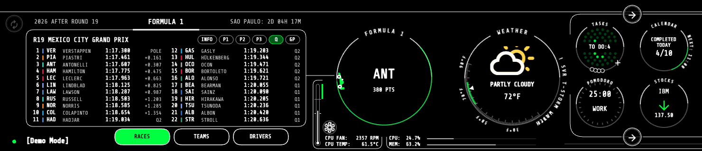

- **DRIVERS** and **TEAMS:** the championship standings with points bars, from the free [Jolpica-F1](https://github.com/jolpica/jolpica-f1) API (no key)
- **RACES:** one race weekend at a time; swipe left or right through the season. **INFO** has the circuit, a countdown to lights out and the sessions in local time; **P1**, **P2**, **P3**, **SQ**, **SP**, **Q** and **GP** show that session's classification (best laps and gaps, qualifying parts, race gaps, points and retirements) from [OpenF1](https://openf1.org)
- The circle shows the championship leader, with the season's progress as a gauge and a small car driving round it

## Sports

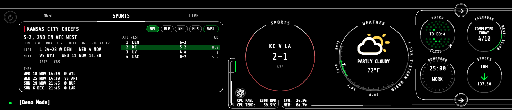

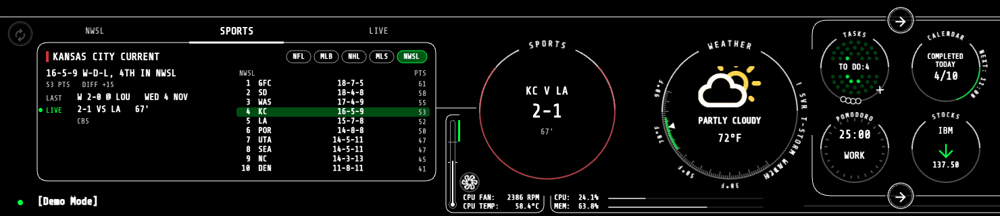

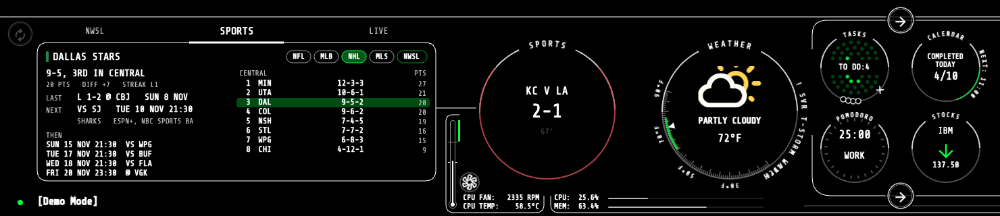

- Your favourite NFL, MLB, NHL, MLS and NWSL teams from ESPN's scores API (no key), set in the [config](doc/configuration.md)
- A button per league: record and standing, last result, next game with its TV channel, the games after it, and the division, conference or table with your team highlighted
- Live scores during your teams' games (clock, down and distance, outs and runners); when a game starts the widget comes to the front
- The circle shows the next game, or the live score

## Horoscope

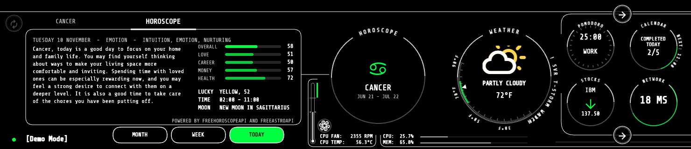

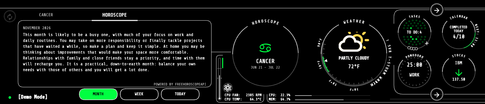

- **TODAY**, **WEEK** and **MONTH** readings for your sign, set in the [config](doc/configuration.md)
- With a free [FreeAstroAPI](https://www.freeastroapi.com) key, TODAY adds love, career, money and health scores, a lucky colour, number and time, and the Moon's phase and sign; the reading itself still comes from FreeHoroscopeAPI, which writes a new one each day
- The circle shows the sign's symbol, name and dates
- Powered by [FreeAstroAPI](https://www.freeastroapi.com) and [FreeHoroscopeAPI](https://freehoroscopeapi.com)

## Word of the Day

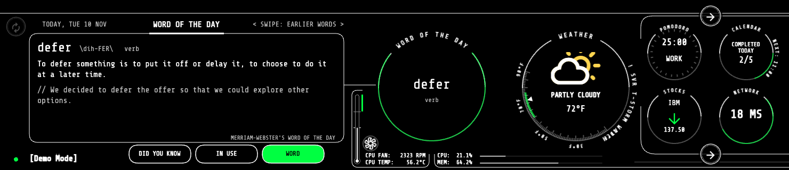

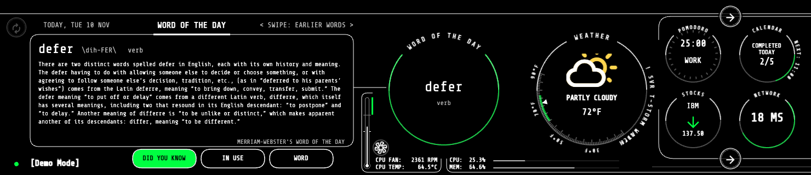

- [Merriam-Webster's Word of the Day](https://www.merriam-webster.com/word-of-the-day) from its public feed (no key)
- **WORD:** pronunciation, part of speech, definition and an example; **IN USE:** a quote from published writing; **DID YOU KNOW:** the story behind the word
- Swipe left or right for the last 10 days' words

## Bambu Lab printers

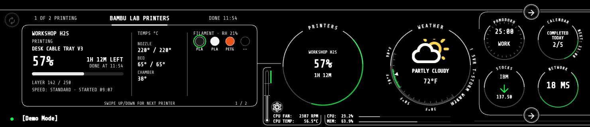

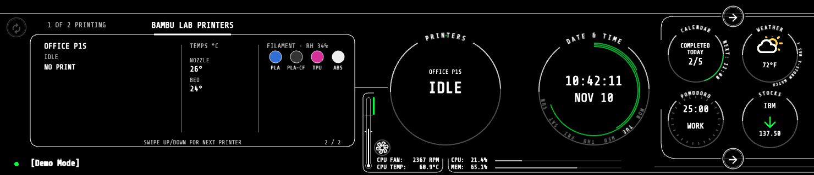

- Print progress for Bambu Lab printers on the local network (LAN MQTT with each printer's access code, set in the [config](doc/configuration.md))
- File, percent, layer, time left and finish time; nozzle, bed and chamber temperatures; AMS filament colours and types, with the slot in use ringed
- View only: nothing is sent to the printers except a status request
- With several printers, swipe up or down to switch; the circle follows the print finishing soonest

## Rocket launches

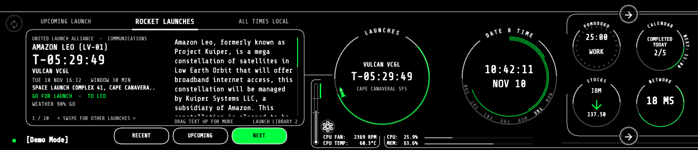

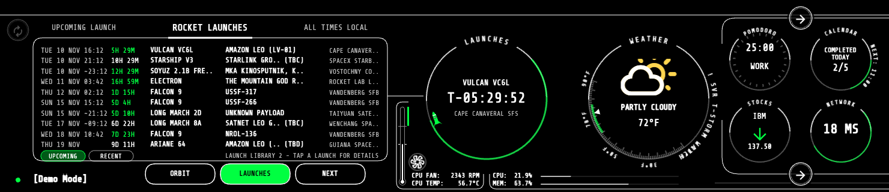

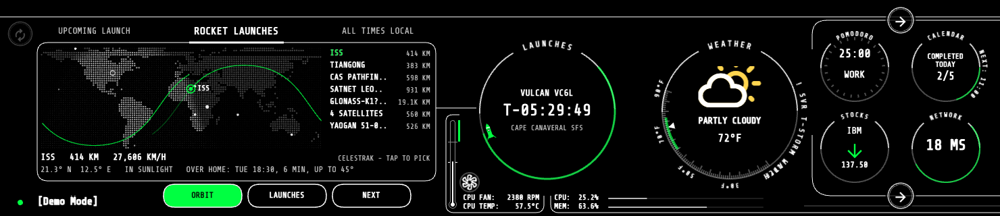

- Launches worldwide from [Launch Library 2](https://thespacedevs.com/llapi) by The Space Devs (free, no key)
- The circle counts down to the next launch; its ring fills over the last day, with a rocket riding the tip that lights its engine in the final hour
- NEXT: mission, rocket, provider, time and window, pad, status, orbit, launch weather and the mission description; swipe for other launches
- LAUNCHES: the next or last ten launches (UPCOMING / RECENT buttons); tap one to see it on NEXT
- ORBIT: where the ISS, Tiangong and recent launches' payloads are now, on a world map lit by the sun, from [CelesTrak](https://celestrak.org) orbital data (free, no key); tap one for its ground track, height, speed, whether it is in sunlight, and for the stations the next pass over home. New launches show up once they are catalogued, usually within a day

## Accent colour

- Pick the accent colour used across every widget from presets or a hue bar
- **Rainbow mode** gives each widget its own colour

## System

- CPU and memory load, CPU temperature and the Pi 5 Active Cooler's fan speed, along the bottom of the screen
- Tap the dot at the bottom left to put the screen to sleep

# Build your own

- [Hardware](doc/install_hardware.md)
- [Software](doc/install_software.md)
- [Configuration](doc/configuration.md)
- [3D printed stand](doc/install_stand.md), or the original project's [wooden case](doc/install_case.md)

# Development

- [Development setup](doc/dev_setup.md), including the demo build and regenerating these screenshots
- [System design](doc/system_desgn.md)
- [Create a widget](doc/dev_create_widget.md)

# Credits

Based on [Desk-HUD](https://github.com/jamro/desk-hud) by [Krzysztof Jamroz](https://github.com/jamro), released under the MIT License. The overall design, the widget framework and the [wooden case](doc/install_case.md) (with its photos) come from his project. Licensed under the MIT License; see [LICENSE](LICENSE).
