# Desk-HUD

A side monitor for my desk: an 11.9" 1480×320 touch screen on a Raspberry Pi 5 that keeps the day in view, with my work and personal calendars, tasks, weather and alerts, a pomodoro timer, stocks, Formula 1 standings and the health of the network, all a tap or a swipe away.

This is my take on [Desk-HUD by Krzysztof Jamroz](https://github.com/jamro/desk-hud). I have rebuilt most of the widgets, added new ones and moved it to a Raspberry Pi 5 in a 3D printed stand. See [Credits](#credits).

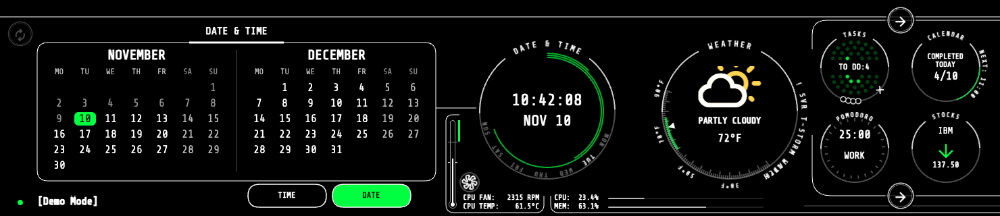

<!-- Add a photo of the finished build here, e.g.  -->

**[Try the demo](https://johnbaikie.github.io/desk-hud/)**: the full interface in your browser, running on simulated data.

# Widgets

The detail screen on the left shows the widget in front; tap any circle to bring it forward. With more widgets than circles, the arrows on the right rotate through the rest.

## Date & Time

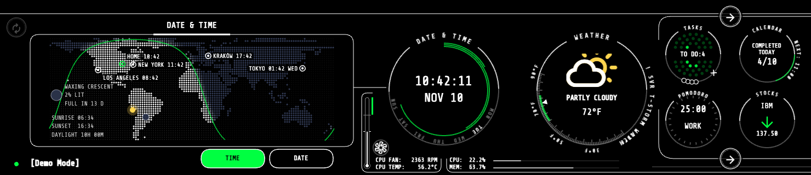

- **DATE:** this month and next as two large calendars. Tap any day to open it in the Calendar widget.
- **TIME:** a dot-matrix world map lit by the sun, with the day/night line, the point where the sun is overhead, and the Moon in its current phase
- Home and the configured time zones with their local times; sunrise, sunset and day length at home; moon phase and days to the next full or new moon

## Weather

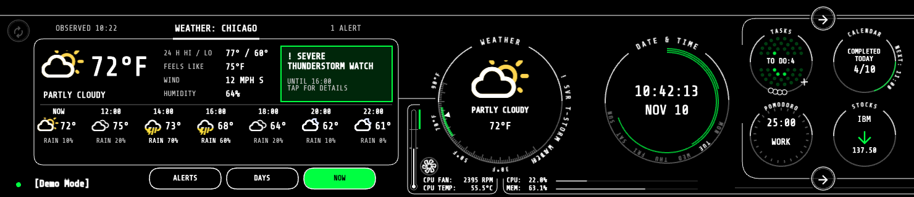

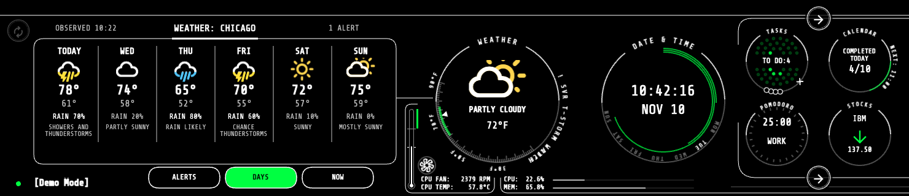

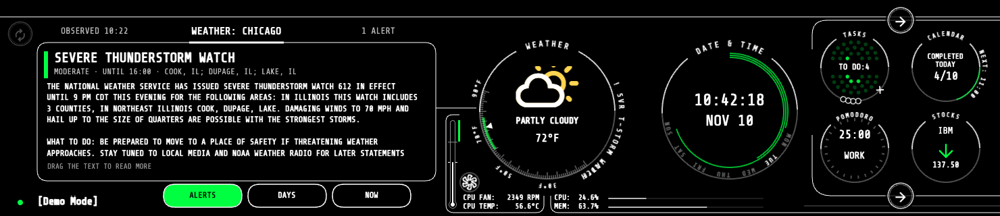

- Current conditions, forecasts and alerts from the US National Weather Service (no API key needed)
- **NOW:** temperature, feels like, wind, humidity and the next 12 hours; **DAYS:** the next six days
- **ALERTS:** active watches and warnings in full. A new warning wakes the screen and brings the widget to the front.
- Coloured weather icons: yellow sun, white cloud, blue rain

## Calendar

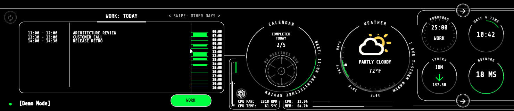

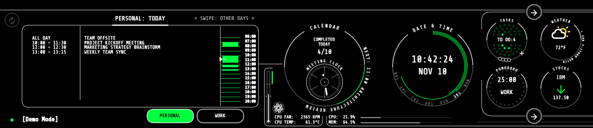

- **WORK** (a published Outlook calendar) and **PERSONAL** (Google Calendar) tabs; swipe left or right for other days
- Busy timeline, all-day events, next meeting and a meeting clock across both calendars

## Tasks

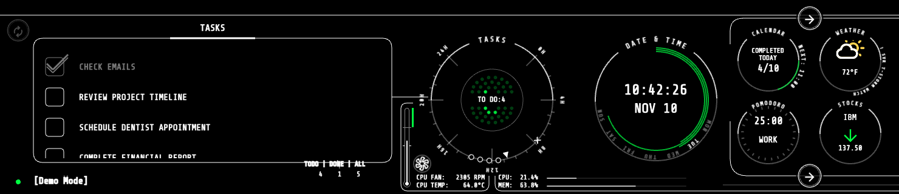

- Every Google Tasks list, plus tasks completed in the last 7 days
- Tick tasks off (or back on) from the screen

## Pomodoro

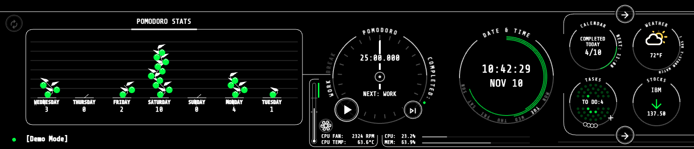

- A [Pomodoro](https://en.wikipedia.org/wiki/Pomodoro_Technique) timer with the next session shown and a skip button
- The last week's completed sessions

## Stocks

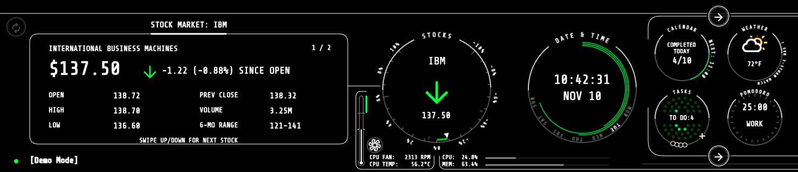

- Price and day change, with open, previous close, high, low, volume and 6-month range, from [StockData](https://www.stockdata.org)
- Several symbols: swipe up or down to switch

## Network

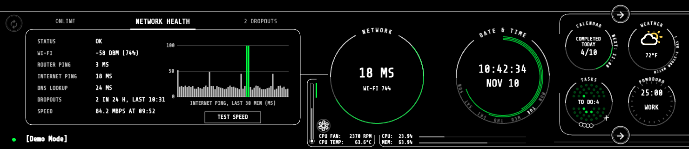

- Wi-Fi signal, router and internet ping, DNS lookup time and dropouts over the last 24 hours
- A 30-minute ping chart and a download speed test (every 3 hours, or on demand)

## Formula 1

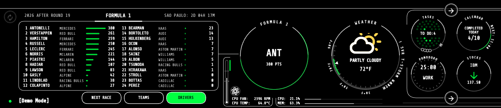

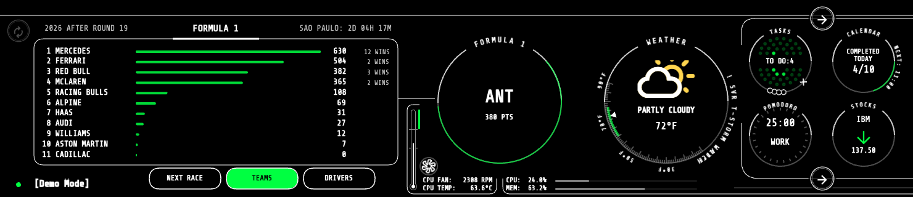

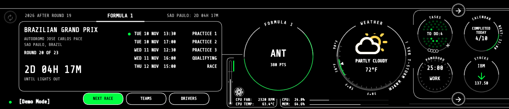

- **DRIVERS** and **TEAMS:** the championship standings with points bars, from the free [Jolpica-F1](https://github.com/jolpica/jolpica-f1) API (no key)
- **NEXT RACE:** the circuit, round, a countdown to lights out and the weekend's sessions in local time
- The circle shows the championship leader, with the season's progress as a gauge

## Accent colour

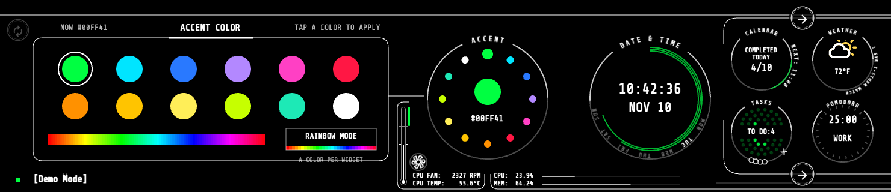

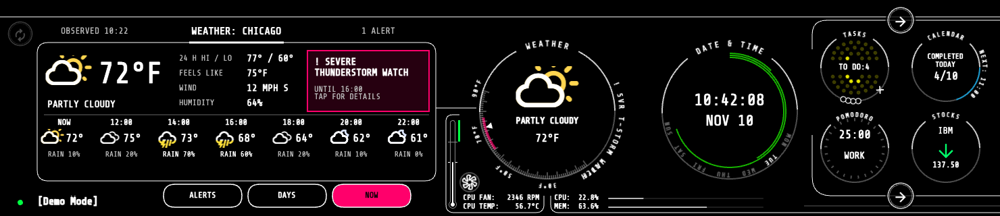

- Pick the accent colour used across every widget from presets or a hue bar
- **Rainbow mode** gives each widget its own colour

## System

- CPU and memory load, CPU temperature and the Pi 5 Active Cooler's fan speed, along the bottom of the screen
- Tap the dot at the bottom left to put the screen to sleep

# Build your own

- [Hardware](doc/install_hardware.md)
- [Software](doc/install_software.md)
- [Configuration](doc/configuration.md)
- [3D printed stand](doc/install_stand.md), or the original project's [wooden case](doc/install_case.md)

# Development

- [Development setup](doc/dev_setup.md), including the demo build and regenerating these screenshots
- [System design](doc/system_desgn.md)
- [Create a widget](doc/dev_create_widget.md)

# Credits

Based on [Desk-HUD](https://github.com/jamro/desk-hud) by [Krzysztof Jamroz](https://github.com/jamro), released under the MIT License. The overall design, the widget framework and the [wooden case](doc/install_case.md) (with its photos) come from his project. Licensed under the MIT License; see [LICENSE](LICENSE).
