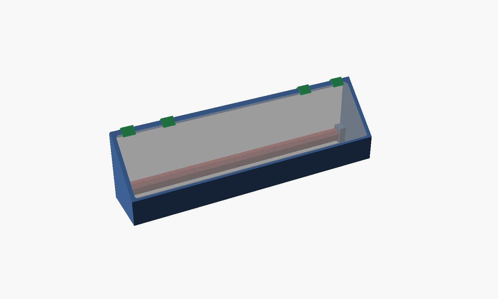
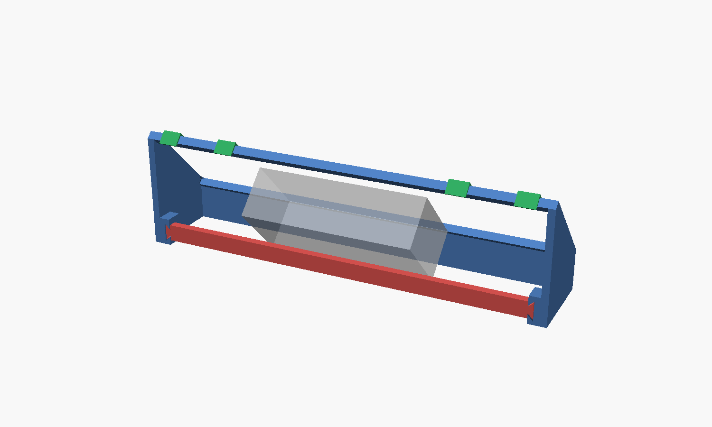
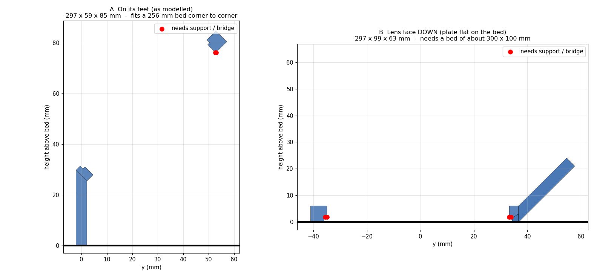
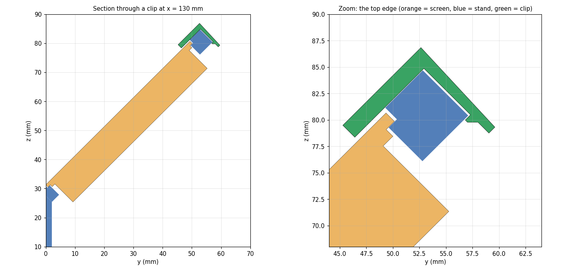
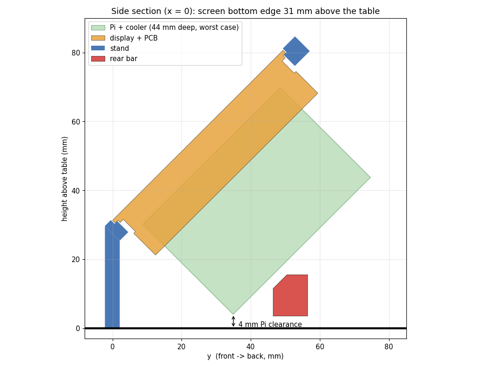
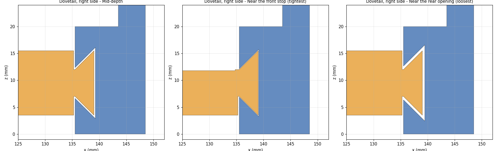

# Install Guide - 3D Printed Stand

A 3D printed alternative to the [wooden case](install_case.md). It holds the [Waveshare 11.9" touch screen](https://www.waveshare.com/11.9inch-hdmi-lcd.htm) at 45° with the Raspberry Pi mounted on its back, and needs no hardware or glue. It can be printed without supports (see [Print](#print)).

The screen sits face-up in a pocket. The LCD module, the PCB and the Raspberry Pi hang through a window in the plate, so the back stays open for cables and airflow. Three printed parts make it up:

- **Stand** - one piece: tilted plate, two end cheeks and a front apron.
- **Rear bar** - a separate tie bar that slides into dovetail sockets on the cheeks.
- **Clips** - four snap-on clips that keep the screen from lifting out of the pocket (optional).

## Files

| File | What it is | Print-tested |
|---|---|---|
| [desk-hud-stand.stl](stl/desk-hud-stand.stl) | Stand, in its natural orientation (on its feet) | yes |
| [desk-hud-stand-lens-down.stl](stl/desk-hud-stand-lens-down.stl) | Same stand, rotated lens-face-down (support-free, [needs a big bed](#print)) | - |
| [desk-hud-stand-bar.stl](stl/desk-hud-stand-bar.stl) | Rear tie bar, already in print orientation | not yet |
| [desk-hud-stand-clips.stl](stl/desk-hud-stand-clips.stl) | 4 retaining clips on one plate | not yet |
| [desk-hud-stand-fit-test.stl](stl/desk-hud-stand-fit-test.stl) | 61 mm end section of the stand (screen corner + dovetail socket) | - |
| [desk-hud-stand-bar-fit-test.stl](stl/desk-hud-stand-bar-fit-test.stl) | About 30 mm of bar end, to try in that socket | - |
| [desk-hud-stand.scad](scad/desk-hud-stand.scad) | Parametric OpenSCAD source of all of the above | - |
| [Makefile](scad/Makefile) | `make` rebuilds every STL and runs the interference checks | - |

"Print-tested" marks what has actually been printed and fitted. The bar and clips were verified in CAD only (see [Verification](#verification)); update this column as they get tested.

## What you need

- A printer with a bed of roughly 300 x 100 mm, or 256 x 256 mm if you accept some [support](#print). PLA is fine.
- The hardware from the [hardware guide](install_hardware.md). Mount the Raspberry Pi on the back of the screen first.
- Nothing else. No screws, glue or inserts.

## Print

The stand is 297 x 59 x 85 mm, so orientation matters:

| Orientation | Size | Bed needed | Supports |
|---|---|---|---|
| **Lens face down** (`-lens-down.stl`) | 297 x 99 x 63 mm | about 300 x 100 mm | None. The only overhang is the thin lens ledge, a 0.4-1.1 mm bridge over the pocket. |
| **On its feet** (`desk-hud-stand.stl`) | 297 x 59 x 85 mm | 256 x 256 mm, placed corner to corner | Under the top edge strip only: its first layers otherwise bridge about 286 mm of air. |

Suggested settings: PLA, 0.2 mm layers, 3-4 perimeters, 15-20 % infill. Lens-down, add a small brim: the first layer is a narrow ridge ring about 297 mm long.

- **Bar:** print as supplied. It lies on its back, so the dovetails run vertically and there are no overhangs.
- **Clips:** print standing on end, as laid out on the plate. The layers then run along the flexing finger, which keeps it from splitting. Do not lay them on their sides.
- **Fit test first:** if you are on a different printer or filament, print the two `fit-test` pieces (about half an hour) before the full stand. Check that the corner of the screen drops into the pocket and that the bar end slides into the socket.

## Assemble

1. Mount the Raspberry Pi to the back of the screen as described in the [hardware guide](install_hardware.md).
2. Lower the screen into the stand from the front, lens first. The module, PCB and Pi (85 x 56 mm) are smaller than the 287 x 68 mm window and pass through it; the lens drops into the pocket and rests on the ledge inside the ridge.
3. Slide the **rear bar** into the dovetail sockets from the back of the stand until it stops. The socket is slightly tapered, so it starts easily and wedges snug as it seats. At the default settings the Pi stack clears the bar by about 3 mm; the bar has a chamfer on its top-front edge for this.
4. Press a **clip** straight down onto the top edge strip at each of the four marked positions until it clicks. A lip reaches over the black border at the top of the lens, 0.45 mm above the glass; it never touches the active area. To remove one, pinch the finger tip back from behind and lift.

The clips hook onto the top edge only, because that is the only place the plate has a back edge to grab. They keep the screen from falling out in normal handling; they are not a hard lock if you tip the whole stand well forward.

## Tuning

Open `scad/desk-hud-stand.scad`; the parameters are at the top.

| Parameter | Default | What it does |
|---|---|---|
| `pi_depth` | 44 mm | How far the Pi and its cooler reach behind the lens face. 44 mm is a starting value: **measure yours** (below). |
| `pi_clear` | 4 mm | Gap kept between the Pi stack and the table. |
| `extra_lift` | 0 | Extra height on top of the computed value. |
| `tilt` | 45° | Screen angle from vertical. |
| `pk_clr` / `win_clr` | 0.30 mm | Clearance of the lens pocket / of the window, per side. |
| `dt_clr_front` / `dt_clr_rear` | 0.10 / 0.45 mm | Dovetail clearance at the front stop / rear opening. |
| `clip_x`, `clip_w` | ±85, ±130 / 14 mm | Clip positions and width. Keep clear of the PCB and HDMI connector (|x| < 70). |

**Measuring `pi_depth`:** lay the screen lens-down on a flat table and measure the height of the highest part of the Pi or its cooler above the table. Each extra millimetre of `pi_depth` raises the stand by about 0.7 mm. With the defaults the lens bottom edge sits 31.3 mm above the table and the Pi stack clears it by 4 mm.

After changing a parameter run `make` in `doc/scad` to regenerate every STL.

## Verification

The stand fits as printed. The checks below cover the rest, and run with `make check`:

- the stand and bar do not touch a model of the screen stack (lens, inner lip, LCD module, PCB and connectors) or a 124 x 56 mm block, 44 mm deep, standing in for the Pi and cooler;
- the bar and stand do not touch each other, with a dovetail clearance that tapers from 0.45 mm to 0.10 mm;
- the clips do not touch the stand, bar, screen or Pi.

A deliberate clash (lowering the stand 12 mm) makes the first check fail, so it does detect overlaps.

The clip numbers (0.7 mm flex, about 1.4 % strain in PLA, about 18 N to press on) are beam-theory estimates, not measurements.

## Troubleshooting

### The Pi or its cooler touches the table
Raise `pi_depth` to the measured value, or add `extra_lift`, then run `make`.

### The screen is too tight or too loose in the pocket
Adjust `pk_clr` (the glass pocket). The lens only overhangs the layer under it by about 0.75 mm at the ends and 1.1 mm top and bottom, so the ledge is narrow.

### The bar is hard to slide in, or falls out
Raise `dt_clr_front` if it is too tight, lower it if it is loose.

### A clip is too stiff, or will not stay on
Lower `clip_f_root` to make the finger more flexible; raise `clip_barb` for a stronger hold.

## Screen dimensions

Taken from the Waveshare drawing and STEP model of the 11.9" HDMI LCD (not redistributed here):

| Part | Size |
|---|---|
| Glass lens | 287.3 x 69.8 x 1.1 mm, R3 corners |
| Layer under the lens ("inner lip") | about 285.8 x 67.6 mm |
| LCD module | 282 x 65 mm |
| PCB and connectors | reach about 16 mm behind the lens face |

## Regenerating

`make` in `doc/scad` needs only [OpenSCAD](https://openscad.org) (tested with 2021.01). `make stl` exports the STLs, `make check` runs the interference checks, and single parts can be exported by hand, for example `openscad -D 'PART="stand"' -o stand.stl desk-hud-stand.scad`.
